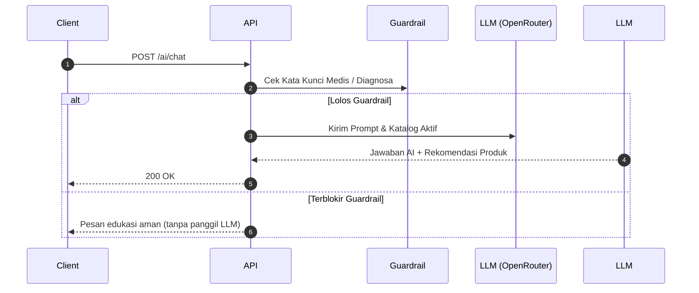
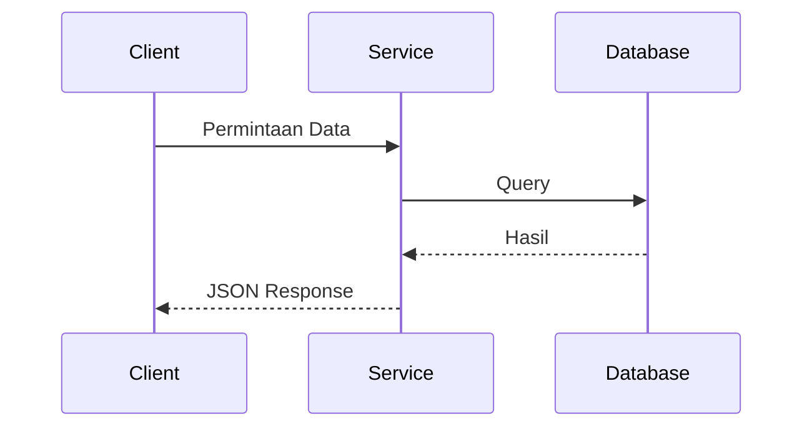

# Panduan Dokumentasi Backend (Folder `docs/`)
### Khusus Pengelolaan Dokumen Backend & Alur Copy-Paste Manual ke Repositori Frontend

Panduan ini ditujukan untuk **Tim Backend (BE)** MamaBear. Dokumen ini menjelaskan aturan penulisan dokumentasi di folder `docs/` repo Backend (`vi-mamabear-backend`) dan tata cara **menyalin (copy-paste) secara manual** ke repositori Frontend (`vi-mamabear-frontend`), sehingga dokumentasi tampil rapi dan interaktif di website dokumentasi:

👉 **URL Dokumentasi Live:** `https://vi-mamabear-frontend.vercel.app/docs/developer/backend`

---

## 1. Alur Kerja (Workflow) Copy-Paste Manual

Dokumentasi MamaBear menggunakan framework **Fumadocs** (berbasis Next.js) yang berada di dalam repositori Frontend. Tim Backend tidak memerlukan konfigurasi CI/CD atau token GitHub Actions yang rumit. Alur kerjanya sangat sederhana:

```text
[Repo vi-mamabear-backend]
  folder: docs/
  (Tulis file .mdx & atur meta.json)
          │
          │ 📋 COPY-PASTE MANUAL
          ▼
[Repo vi-mamabear-frontend]
  folder: mamabear-docs/content/docs/developer/backend/
          │
          │ 🚀 Git Commit & Push ke main
          ▼
[Vercel Live Deployment]
  https://vi-mamabear-frontend.vercel.app/docs/developer/backend
```

1. **Tulis & Edit di Backend**: Semua dokumen teknis backend ditulis di dalam folder `docs/` di repo ini dengan format `.mdx`.
2. **Copy-Paste Manual ke Frontend**: Kapan pun ada update atau fitur baru, salin file `.mdx` dan `meta.json` ke folder target di repo frontend.
3. **Commit & Push di Frontend**: Commit perubahan di repo frontend, lalu Vercel akan otomatis melakukan *build* dan *deploy* dalam 1–2 menit.

---

## 2. Struktur Folder `docs/` & Aturan Penamaan File

### 2.1 Struktur Standar Folder `docs/`

Struktur folder `docs/` diatur agar langsung mencerminkan struktur navigasi sidebar di Fumadocs:

```text
vi-mamabear-backend/
├── PANDUAN_DOKUMENTASI_BE.md  # Panduan ini (di root, tidak di-copas ke FE)
└── docs/
    ├── meta.json               # WAJIB: Mengatur judul kategori & urutan menu di sidebar
    ├── index.mdx               # WAJIB: Halaman utama / landing page dokumentasi backend
    ├── arsitektur.mdx          # Penjelasan arsitektur (Controller, Service, Repository)
    ├── api-reference.mdx       # Standar REST API, format JSON, & daftar endpoint
    ├── fitur-ai.mdx            # Dokumentasi AI Assistant, prompt, fallback, & sanitasi
    ├── product-guardrail.mdx   # Kebijakan guardrail produk, embedding pgvector, & kalibrasi
    ├── database.mdx            # Skema database Prisma, ERD, relasi, & seeder
    └── pemeliharaan.mdx        # Panduan deployment (Docker / PM2), logs, & migrasi
```

> [!NOTE]
> File dokumentasi yang saat ini sudah ada di folder `docs/` (`AI-FEATURE.md`, `MAINTENANCE.md`, `product-guardrail.md`) dapat diubah ekstensinya menjadi `.mdx` dan disesuaikan format frontmatter-nya sesuai panduan ini.

### 2.2 Aturan Penamaan File
1. **Wajib Ekstensi `.mdx`**:
   - Gunakan `.mdx` (bukan `.md`) agar komponen interaktif (Callout, Tabs, Steps, Cards) dapat dirender sempurna oleh Fumadocs.
2. **Format `kebab-case.mdx`**:
   - Gunakan huruf kecil (*lowercase*) dan tanda strip (`-`).
   - Contoh **BENAR**: `fitur-ai.mdx`, `pemeliharaan.mdx`, `api-reference.mdx`.
   - Contoh **SALAH**: `AI-FEATURE.md`, `FiturAI.mdx`, `fitur_ai.mdx`, `fitur ai.mdx`.
3. **Wajib Memiliki `index.mdx`**:
   - `index.mdx` adalah halaman yang pertama kali terbuka saat pengunjung mengakses URL `/docs/developer/backend`.

---

## 3. Konfigurasi `meta.json` (Urutan Navigasi Sidebar)

Fumadocs membaca file `meta.json` untuk menentukan urutan halaman di sidebar kiri.

**Contoh isi `docs/meta.json`:**
```json
{
  "title": "Backend Guide",
  "description": "Dokumentasi teknis arsitektur, API, database, dan layanan backend MamaBear.",
  "pages": [
    "index",
    "arsitektur",
    "api-reference",
    "fitur-ai",
    "product-guardrail",
    "database",
    "pemeliharaan"
  ]
}
```

> [!IMPORTANT]
> - Nilai dalam array `"pages"` adalah nama file **tanpa ekstensi `.mdx`**.
> - Halaman `"index"` harus selalu berada di urutan paling atas.
> - Setiap membuat file `.mdx` baru, **wajib** mendaftarkan slug file tersebut ke dalam array `"pages"` pada `meta.json`.

---

## 4. Format Dokumen MDX

Setiap file `.mdx` terdiri dari **Frontmatter** (metadata di baris paling atas) dan **Body** (isi teks dan komponen).

### 4.1 Format Frontmatter (Header Wajib)

Setiap file `.mdx` **wajib** diawali dengan blok frontmatter berikut di baris pertama:

```yaml
---
title: Fitur AI Assistant
description: Arsitektur layanan AI, integrasi OpenRouter LLM, guardrail medis, dan pencarian produk.
---
```

**Ketentuan:**
- `title`: Judul halaman yang ringkas (Title Case). Hindari kata berulang seperti *"Dokumentasi Fitur AI"* — cukup *"Fitur AI Assistant"*.
- `description`: Penjelasan singkat 1–2 kalimat. Teks ini otomatis muncul di bawah judul halaman dan digunakan untuk preview SEO.

### 4.2 Aturan Heading Dokumen
- **DILARANG menggunakan Heading 1 (`# Judul`)** di dalam body, karena H1 sudah otomatis dibuatkan oleh Fumadocs dari `title` di frontmatter.
- Gunakan **`##` (Heading 2)** untuk sub-judul topik utama.
- Gunakan **`###` (Heading 3)** untuk sub-topik berikutnya.
- Gunakan **`####` (Heading 4)** untuk poin detail spesifik.

---

## 5. Komponen Interaktif Fumadocs yang Tersedia

Fumadocs mendukung komponen MDX berikut. Tim BE dapat langsung menggunakannya di dalam file `.mdx`:

### 5.1 Callout (Catatan, Peringatan, Informasi Penting)
```mdx
<Callout type="info">
  Endpoint ini memerlukan autentikasi Bearer Token (JWT).
</Callout>

<Callout type="warn">
  Jangan pernah melakukan commit kredensial database atau API Key produksi ke repositori.
</Callout>

<Callout type="error">
  Penghapusan produk bersifat soft-delete untuk menjaga integritas transaksi masa lalu.
</Callout>
```

### 5.2 Tabs (Contoh Request & Multi-Response API)
````mdx
<Tabs items={['Request JSON', 'Response 200 OK', 'Response 429 Too Many Requests']}>
  <Tab value="Request JSON">
    ```json
    {
      "message": "Apakah MamaBear Almond Milk aman untuk ibu hamil?",
      "conversation_id": "conv_123"
    }
    ```
  </Tab>
  <Tab value="Response 200 OK">
    ```json
    {
      "status": "success",
      "data": {
        "reply": "MamaBear Almond Milk sangat aman dan direkomendasikan...",
        "products": [
          { "id": 1, "name": "MamaBear Teh Pelancar ASI" }
        ]
      }
    }
    ```
  </Tab>
  <Tab value="Response 429 Too Many Requests">
    ```json
    {
      "status": "error",
      "message": "Batas pesan terlampaui. Silakan coba kembali dalam beberapa saat."
    }
    ```
  </Tab>
</Tabs>
````

### 5.3 Steps (Instruksi Langkah demi Langkah)
```mdx
<Steps>
  <Step>
    #### Jalankan Migrasi Database
    ```bash
    npx prisma migrate deploy
    ```
  </Step>

  <Step>
    #### Isi Data Awal (Seeding)
    ```bash
    npm run prisma:seed
    ```
  </Step>
</Steps>
```

### 5.4 Cards & CardGrid (Navigasi Antar Halaman)
Cocok digunakan pada `index.mdx` untuk menghubungkan ke bab lain:
```mdx
<Cards>
  <Card title="Fitur AI Assistant" href="/docs/developer/backend/fitur-ai" description="Panduan LLM, guardrail medis, dan integrasi OpenRouter." />
  <Card title="Pemeliharaan Sistem" href="/docs/developer/backend/pemeliharaan" description="Panduan operasional Docker, migrasi, dan log server." />
</Cards>
```

### 5.5 Diagram Alur (Mermaid)
Tulis diagram arsitektur atau urutan proses tanpa perlu membuat file gambar:
````mdx

````

---

## 6. Panduan Gambar & File Lampiran

### 6.1 Menyematkan Gambar / Screenshot
Untuk alur kerja copy-paste manual, **sangat disarankan menggunakan GitHub Raw URL** dari repo Backend. Dengan cara ini, saat file `.mdx` di-copas ke repo FE, link gambar langsung bekerja tanpa perlu menyalin folder gambar ke FE.

```mdx

```

> [!TIP]
> - Simpan gambar di `docs/assets/nama-file.png`.
> - Gunakan format **PNG** atau **WebP**.
> - Kompres ukuran gambar agar di bawah 500 KB sebelum di-push.

---

## 7. Langkah demi Langkah: Copy-Paste ke Repo Frontend

Berikut adalah prosedur lengkap saat hendak mempublikasikan dokumentasi dari repo Backend ke Frontend:

### Lokasi Direktori:
- **Asal (Repo Backend)**: `vi-mamabear-backend/docs/`
- **Tujuan (Repo Frontend)**: `vi-mamabear-frontend/mamabear-docs/content/docs/developer/backend/`

---

### Cara 1: Menggunakan Terminal / Command Line (Paling Cepat)

Jika folder repo `vi-mamabear-backend` dan `vi-mamabear-frontend` berada dalam satu folder induk (bersebelahan):

```bash
# 1. Pastikan Anda berada di direktori vi-mamabear-backend
pwd

# 2. Salin seluruh file .mdx dan meta.json ke folder backend di repo FE
cp docs/*.mdx ../vi-mamabear-frontend/mamabear-docs/content/docs/developer/backend/
cp docs/meta.json ../vi-mamabear-frontend/mamabear-docs/content/docs/developer/backend/

# 3. Pindah ke repo Frontend untuk commit & push
cd ../vi-mamabear-frontend
git status
git add mamabear-docs/content/docs/developer/backend/
git commit -m "docs(backend): sync backend documentation from backend repo"
git push origin main
```

---

### Cara 2: Menggunakan File Explorer / Finder / VS Code (Manual Drag & Drop)

1. Buka File Explorer / Finder atau buka kedua repositori di VS Code.
2. Buka folder `vi-mamabear-backend/docs/`.
3. Pilih semua file dokumentasi (`meta.json`, `index.mdx`, dan semua file `*.mdx`).
4. Salin (*Copy*) file-file tersebut.
5. Buka folder `vi-mamabear-frontend/mamabear-docs/content/docs/developer/backend/`.
6. Tempel (*Paste / Replace*) file-file tersebut.
7. Di repo Frontend, lakukan:
   ```bash
   git add .
   git commit -m "docs(backend): update backend docs"
   git push origin main
   ```

---

### Verifikasi Hasil di Frontend (Opsional tapi Disarankan)

Jika ingin melihat tampilan lokal sebelum di-push ke GitHub:
```bash
cd vi-mamabear-frontend/mamabear-docs
npm run dev
```
Buka browser di:
👉 `http://localhost:3000/docs/developer/backend`

Setelah di-push ke branch `main`, Vercel akan otomatis melakukan deploy ke URL live:
👉 `https://vi-mamabear-frontend.vercel.app/docs/developer/backend`

---

## 8. Template Halaman Baru (`template.mdx`)

Gunakan template di bawah ini saat membuat halaman baru di `docs/`:

````mdx
---
title: Judul Modul / Fitur
description: Ringkasan singkat modul ini dalam 1 atau 2 kalimat.
---

Penjelasan pembuka mengenai fungsi modul atau layanan ini di backend MamaBear.

## Arsitektur & Alur Kerja

Jelaskan bagaimana modul ini bekerja secara konseptual.



## Spesifikasi Endpoint

### Nama Aksi / Endpoint
- **Method**: `POST`
- **Path**: `/api/v1/contoh`
- **Autentikasi**: `Bearer Token (JWT)`

<Tabs items={['Request Payload', 'Response 200 OK', 'Response Error']}>
  <Tab value="Request Payload">
    ```json
    {
      "field_name": "value"
    }
    ```
  </Tab>
  <Tab value="Response 200 OK">
    ```json
    {
      "status": "success",
      "data": {
        "id": "123"
      }
    }
    ```
  </Tab>
  <Tab value="Response Error">
    ```json
    {
      "status": "error",
      "message": "Field required"
    }
    ```
  </Tab>
</Tabs>

<Callout type="info">
  Tambahkan catatan penting atau batas penggunaan di sini.
</Callout>
````

---

## 9. Checklist Sebelum Melakukan Copy-Paste ke FE

Sebelum menyalin file dari `docs/` ke repo FE, pastikan:

- [ ] Ekstensi file adalah `.mdx` dan format nama file adalah `kebab-case.mdx`.
- [ ] Setiap file memiliki header frontmatter (`--- title: ... description: ... ---`) di baris 1.
- [ ] Tidak ada `# Heading 1` di dalam isi dokumen (mulai dari `## Heading 2`).
- [ ] Slug nama file sudah didaftarkan ke dalam array `"pages"` di `docs/meta.json`.
- [ ] Tidak ada secret, password database, JWT secret, atau API Key asli yang tertulis di teks.
- [ ] Semua blok kode memiliki tag bahasa yang jelas (misal: ` ```typescript `, ` ```json `, ` ```bash `).
- [ ] Link gambar dapat diakses dan tidak rusak.
