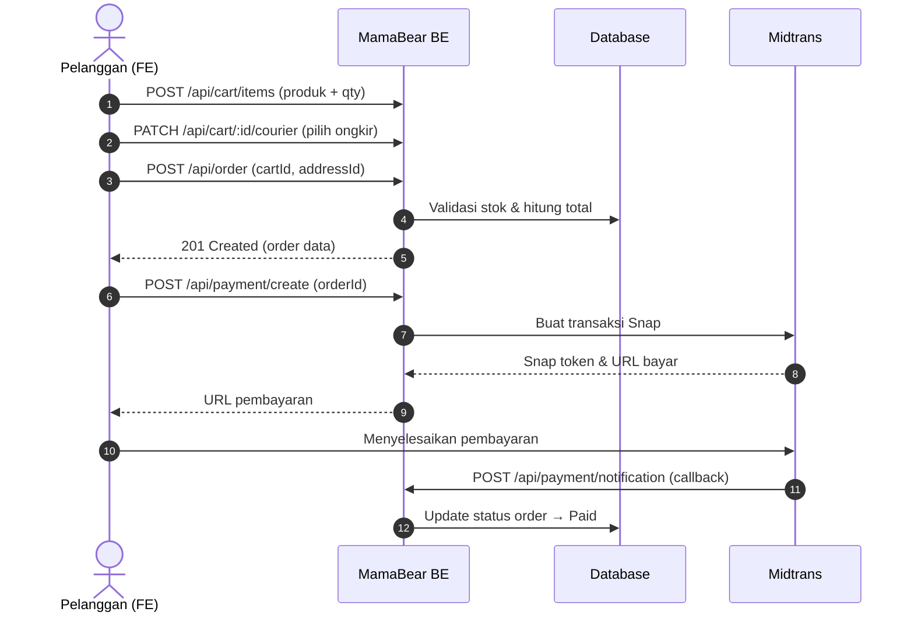

Halaman ini adalah referensi lengkap konvensi REST API MamaBear: format respons, autentikasi, pagination, serta katalog seluruh endpoint yang aktif di server backend.

<Callout type="info">
  Semua endpoint wajib diawali prefix global `/api` (`app.setGlobalPrefix('/api')`). Contoh: `/api/products`.
</Callout>

## Base URL

| Lingkungan | Base URL |
| :--- | :--- |
| Production | `https://vi-mamabear-backend.onrender.com/api` |
| Lokal | `http://localhost:3000/api` |

Frontend mem-proxy `/api/backend/*` ke server backend production di Render.

---

## Konvensi Standar Respons JSON

Setiap respons — sukses maupun gagal — dibungkus envelope yang sama oleh `TransformInterceptor` dan `AllExceptionsFilter`:

<Tabs items={['Respons Sukses (200/201)', 'Respons Error Validasi (400)', 'Respons Unauthorized (401)', 'Respons Tidak Ditemukan (404)']}>
  <Tab value="Respons Sukses (200/201)">
    ```json
    {
      "success": true,
      "statusCode": 200,
      "message": ["Produk berhasil diambil"],
      "data": {
        "id": 1,
        "name": "MamaBear Teh Pelancar ASI",
        "price": 42000
      },
      "timestamp": "2026-10-14T10:15:30.123Z"
    }
    ```
  </Tab>
  <Tab value="Respons Error Validasi (400)">
    ```json
    {
      "success": false,
      "statusCode": 400,
      "message": ["email must be an email", "password must be longer than or equal to 8 characters"],
      "data": null,
      "timestamp": "2026-10-14T10:15:30.123Z"
    }
    ```
  </Tab>
  <Tab value="Respons Unauthorized (401)">
    ```json
    {
      "success": false,
      "statusCode": 401,
      "message": ["Unauthorized"],
      "data": null,
      "timestamp": "2026-10-14T10:15:30.123Z"
    }
    ```
  </Tab>
  <Tab value="Respons Tidak Ditemukan (404)">
    ```json
    {
      "success": false,
      "statusCode": 404,
      "message": ["Cannot GET /api/path"],
      "data": null,
      "timestamp": "2026-10-14T10:15:30.123Z"
    }
    ```
  </Tab>
</Tabs>

| Field | Tipe | Keterangan |
| :--- | :--- | :--- |
| `success` | `boolean` | `true` bila sukses, `false` bila error |
| `statusCode` | `number` | Status HTTP yang sama dengan response header |
| `message` | `string[]` | Selalu berupa **array of string** |
| `data` | `any \| null` | Payload bisnis; `null` pada error |
| `timestamp` | `string` | Waktu server dalam format ISO 8601 (UTC) |

---

## Autentikasi & Authorization

Endpoint bertanda **Authed** / **Admin** memerlukan HTTP Header:

```http
Authorization: Bearer <ACCESS_TOKEN>
```

<Tabs items={['Login', 'Response Login', 'Refresh Token']}>
  <Tab value="Login">
    ```http
    POST /api/auth/login
    Content-Type: application/json

    {
      "email": "siti.rahayu@email.com",
      "password": "password123"
    }
    ```
  </Tab>
  <Tab value="Response Login">
    ```json
    {
      "success": true,
      "statusCode": 201,
      "message": ["Login successful"],
      "data": {
        "accessToken": "eyJhbGciOi...",
        "refreshToken": "eyJhbGciOi..."
      },
      "timestamp": "2026-10-14T10:15:30.123Z"
    }
    ```
  </Tab>
  <Tab value="Refresh Token">
    ```http
    POST /api/auth/refresh
    Authorization: Bearer <REFRESH_TOKEN>

    → 200 { "accessToken": "...", "refreshToken": "..." }
    ```
  </Tab>
</Tabs>

- **Access token**: berlaku **15 menit**, dibawa di header `Authorization`.
- **Refresh token**: berlaku **7 hari**, dikirim balik ke `POST /api/auth/refresh` (guard khusus `RefreshGuard`) untuk memperoleh pasangan token baru.
- **Role**: `USER`, `ADMIN`, `SUPERADMIN`. Endpoint admin dijaga `JwtAuthGuard` + `RolesGuard`.
- **Rate limit**: seluruh endpoint `auth` dibatasi **50 request / 5 menit** per IP (`ThrottlerGuard`).

<Callout type="warn">
  Token lama tidak otomatis diperbarui. Simpan `refreshToken` dari response login dan gunakan endpoint refresh sebelum access token kedaluwarsa.
</Callout>

---

## Pagination

Sebagian besar endpoint list (produk, order, dll) memakai cursor pagination:

| Query Param | Tipe | Default | Maksimum |
| :--- | :--- | :--- | :--- |
| `cursor` | `number` (min 1) | `1` | — |
| `limit` | `number` | `10` | `10` |

```http
GET /api/products?cursor=1&limit=10
```

---

## Katalog Endpoint

Keterangan kolom **Akses**: `Publik` (tanpa token) · `Authed` (JWT) · `Optional JWT` (tanpa token tetap boleh) · `Admin` (`ADMIN`/`SUPERADMIN`) · `Superadmin` (`SUPERADMIN`) · `Webhook` (dipanggil payment gateway).

### Auth & Akun

| Method | Endpoint | Akses | Keterangan |
| :--- | :--- | :--- | :--- |
| `POST` | `/api/auth/register` | Publik | Registrasi akun baru (email, password 8-24, name, phone) |
| `POST` | `/api/auth/login` | Publik | Login, mengembalikan `accessToken` + `refreshToken` |
| `POST` | `/api/auth/refresh` | Refresh token | Menukar refresh token dengan pasangan token baru |
| `GET` | `/api/auth/me` | Authed | Profil user yang sedang login |
| `POST` | `/api/auth/logout` | Authed | Logout & invalidasi refresh token |
| `POST` | `/api/auth/forgot-password` | Publik | Kirim link reset password ke email |
| `POST` | `/api/auth/reset-password/:token` | Publik | Set password baru via token reset |
| `GET` | `/api/auth/verify-email/:token` | Publik | Verifikasi email akun baru |

### Katalog Produk (Publik)

| Method | Endpoint | Akses | Keterangan |
| :--- | :--- | :--- | :--- |
| `GET` | `/api/products` | Publik | Daftar produk (cursor pagination) |
| `GET` | `/api/products/search` | Publik | Pencarian produk `?q=...` |
| `GET` | `/api/products/filter` | Publik | Filter produk (kategori, harga, dll) |
| `GET` | `/api/products/search/suggestions` | Publik | Autocomplete saran pencarian |
| `GET` | `/api/products/:slug` | Publik | Detail satu produk berdasarkan slug |
| `GET` | `/api/products/:slug/related` | Publik | Produk terkait |
| `GET` | `/api/products/:slug/variants` | Publik | Varian (ukuran/varian) satu produk |
| `GET` | `/api/products/:slug/reviews` | Publik | Daftar ulasan produk |
| `GET` | `/api/products/:slug/reviews/summary` | Publik | Ringkasan rating ulasan |
| `POST` | `/api/products/:slug/reviews` | Authed | Tulis ulasan produk |
| `PATCH` | `/api/products/:slug/reviews/:reviewId/upvote` | Authed | Beri/upvote ulasan |

### Kategori & Highlight (Publik)

| Method | Endpoint | Akses | Keterangan |
| :--- | :--- | :--- | :--- |
| `GET` | `/api/categories` | Publik | Daftar semua kategori |
| `GET` | `/api/categories/:slug` | Publik | Detail kategori berdasarkan slug |
| `GET` | `/api/highlights` | Publik | Daftar konten highlight/banner |
| `GET` | `/api/highlights/:id` | Publik | Detail satu highlight |

### Keranjang

<Callout type="info">
  Controller cart memakai `OptionalJwtAuthGuard` — tamu (tanpa token) tetap bisa memakai keranjang, token dibawa bila login untuk merge keranjang.
</Callout>

| Method | Endpoint | Akses | Keterangan |
| :--- | :--- | :--- | :--- |
| `GET` | `/api/cart` | Optional JWT | Ambil isi keranjang aktif |
| `GET` | `/api/cart/totals` | Optional JWT | Ringkasan total belanja |
| `POST` | `/api/cart/items` | Optional JWT | Tambah item (`productId`, `variantId`, `quantity`) |
| `PATCH` | `/api/cart/items/:id` | Optional JWT | Ubah jumlah item |
| `DELETE` | `/api/cart/items/:id` | Optional JWT | Hapus satu item |
| `POST` | `/api/cart/merge` | Optional JWT | Merge keranjang tamu ke akun login |
| `POST` | `/api/cart/validate` | Optional JWT | Validasi keranjang sebelum checkout |
| `PATCH` | `/api/cart/:id/courier` | Optional JWT | Pilih kurir/layanan pengiriman |
| `DELETE` | `/api/cart/:id/courier` | Optional JWT | Batalkan pilihan kurir |
| `POST` | `/api/cart/promo` | Optional JWT | Terapkan kode promo |
| `DELETE` | `/api/cart/promo` | Optional JWT | Hapus promo yang diterapkan |
| `DELETE` | `/api/cart` | Optional JWT | Kosongkan keranjang |

### Alamat (`/api/me/addresses`)

| Method | Endpoint | Akses | Keterangan |
| :--- | :--- | :--- | :--- |
| `POST` | `/api/me/addresses` | Authed | Tambah alamat baru |
| `GET` | `/api/me/addresses` | Authed | Daftar alamat milik user |
| `GET` | `/api/me/addresses/:id` | Authed | Detail satu alamat |
| `PUT` | `/api/me/addresses/:id` | Authed | Perbarui alamat |
| `DELETE` | `/api/me/addresses/:id` | Authed | Hapus alamat |

### Pengiriman (RajaOngkir)

| Method | Endpoint | Akses | Keterangan |
| :--- | :--- | :--- | :--- |
| `GET` | `/api/shipping/province` | Authed | Daftar provinsi |
| `GET` | `/api/shipping/city/:provinceId` | Authed | Daftar kota per provinsi |
| `GET` | `/api/shipping/district/:cityId` | Authed | Daftar kecamatan per kota |
| `GET` | `/api/shipping/subdistrict/:districtId` | Authed | Daftar kelurahan per kecamatan |
| `POST` | `/api/shipping/cost` | Authed | Cek ongkos kirim |

### Order

| Method | Endpoint | Akses | Keterangan |
| :--- | :--- | :--- | :--- |
| `POST` | `/api/order` | Authed | Checkout: buat order dari keranjang (`cartId`, `addressId`, `notes?`) |
| `GET` | `/api/order` | Authed | Riwayat order milik user |
| `GET` | `/api/order/:id` | Authed | Detail satu order |
| `GET` | `/api/order/:id/invoice` | Authed | Unduh invoice order |
| `POST` | `/api/order/:id/cancel` | Authed | Batalkan order |

### Pembayaran (Midtrans)

| Method | Endpoint | Akses | Keterangan |
| :--- | :--- | :--- | :--- |
| `POST` | `/api/payment/create` | Authed | Buat transaksi Midtrans (`orderId`) → Snap token & URL bayar |
| `POST` | `/api/payment/notification` | Webhook | Callback status pembayaran dari Midtrans (dipanggil Midtrans, bukan frontend) |

### AI Assistant

| Method | Endpoint | Akses | Keterangan |
| :--- | :--- | :--- | :--- |
| `POST` | `/api/ai/chat` | Authed | Kirim pesan chat AI (dilindungi `UserThrottlerGuard`) |
| `GET` | `/api/ai/conversations` | Authed | Daftar percakapan |
| `GET` | `/api/ai/history/:conversationId` | Authed | Riwayat pesan satu percakapan |
| `DELETE` | `/api/ai/conversations/:conversationId` | Authed | Hapus percakapan |

### Utilitas

| Method | Endpoint | Akses | Keterangan |
| :--- | :--- | :--- | :--- |
| `GET` | `/api/health` | Publik | Health check server |

### Admin — Produk (`/api/admin/products`, ADMIN/SUPERADMIN)

| Method | Endpoint | Akses | Keterangan |
| :--- | :--- | :--- | :--- |
| `GET` | `/api/admin/products` | Admin | Daftar produk (termasuk non-published) |
| `POST` | `/api/admin/products` | Admin | Buat produk baru |
| `GET` | `/api/admin/products/export` | Admin | Export daftar produk (CSV) |
| `GET` | `/api/admin/products/:id` | Admin | Detail produk by ID |
| `POST` | `/api/admin/products/:id/duplicate` | Admin | Duplikasi produk |
| `PUT` | `/api/admin/products/:id` | Admin | Perbarui produk |
| `DELETE` | `/api/admin/products/:id` | Admin | Hapus produk |
| `DELETE` | `/api/admin/products/bulk-delete` | Admin | Hapus banyak produk |
| `PATCH` | `/api/admin/products/bulk-publish` | Admin | Ubah status publish massal |
| `POST` | `/api/admin/products/:id/variants` | Admin | Tambah varian produk |
| `GET` | `/api/admin/products/:id/variants` | Admin | Daftar varian produk |
| `PUT` | `/api/admin/products/variants/:id` | Admin | Perbarui varian |
| `DELETE` | `/api/admin/products/variants/:id` | Admin | Hapus varian |
| `POST` | `/api/admin/products/:id/variants/:variantId/discount` | Admin | Pasang diskon varian |
| `GET` | `/api/admin/products/:id/reviews` | Admin | Daftar ulasan produk |
| `DELETE` | `/api/admin/products/:id/reviews/:reviewId` | Admin | Hapus ulasan produk |
| `DELETE` | `/api/admin/products/reviews/:id` | Admin | Hapus ulasan by ID |

### Admin — Kategori, Highlight, Upload, Pengaturan

| Method | Endpoint | Akses | Keterangan |
| :--- | :--- | :--- | :--- |
| `POST` | `/api/admin/categories` | Admin | Buat kategori |
| `PUT` | `/api/admin/categories/:id` | Admin | Perbarui kategori |
| `DELETE` | `/api/admin/categories/:id` | Admin | Hapus kategori |
| `POST` | `/api/admin/highlights` | Admin | Buat highlight |
| `PATCH` | `/api/admin/highlights/:id` | Admin | Perbarui highlight |
| `DELETE` | `/api/admin/highlights/:id` | Admin | Hapus highlight |
| `GET` | `/api/admin/upload/signature` | Admin | Signature upload Cloudinary |
| `POST` | `/api/admin/upload/image` | Admin | Upload satu gambar |
| `POST` | `/api/admin/upload/images` | Admin | Upload banyak gambar |
| `GET` | `/api/admin/upload/images` | Admin | Daftar gambar ter-upload |
| `DELETE` | `/api/admin/upload/image/:id` | Admin | Hapus gambar |
| `GET` | `/api/admin/settings` | Admin | Daftar semua pengaturan |
| `GET` | `/api/admin/settings/:key` | Admin | Ambil satu pengaturan |
| `PUT` | `/api/admin/settings/:key` | Admin | Perbarui pengaturan |

### Admin — Order (`/api/admin/order`, ADMIN/SUPERADMIN)

| Method | Endpoint | Akses | Keterangan |
| :--- | :--- | :--- | :--- |
| `GET` | `/api/admin/order` | Admin | Daftar semua order (filter & pagination) |
| `GET` | `/api/admin/order/export` | Admin | Export order (CSV) |
| `GET` | `/api/admin/order/:id` | Admin | Detail order |
| `GET` | `/api/admin/order/:id/invoice` | Admin | Invoice order |
| `POST` | `/api/admin/order/:id/cancel` | Admin | Batalkan order oleh admin |
| `PATCH` | `/api/admin/order/:id/status` | Admin | Ubah status order |
| `PATCH` | `/api/admin/order/:id/tracking` | Admin | Update nomor resi/pelacakan |

### Admin — Pelanggan & Pengguna

| Method | Endpoint | Akses | Keterangan |
| :--- | :--- | :--- | :--- |
| `GET` | `/api/admin/customers` | Admin | Daftar pelanggan |
| `GET` | `/api/admin/customers/export` | Admin | Export pelanggan (CSV) |
| `GET` | `/api/admin/customers/:id` | Admin | Detail pelanggan |
| `PUT` | `/api/admin/customers/:id/status` | Admin | Aktif/nonaktifkan pelanggan |
| `GET` | `/api/admin/users` | Admin | Daftar seluruh user |
| `GET` | `/api/admin/users/:id` | Admin | Detail user |
| `POST` | `/api/admin/users` | Superadmin | Buat user baru |
| `PUT` | `/api/admin/users/:id/role` | Superadmin | Ubah role user |
| `PUT` | `/api/admin/users/:id/status` | Superadmin | Ubah status user |
| `DELETE` | `/api/admin/users/:id` | Superadmin | Hapus user |

### Admin — Laporan, Aktivitas, Promo

| Method | Endpoint | Akses | Keterangan |
| :--- | :--- | :--- | :--- |
| `GET` | `/api/admin/reports/dashboard` | Admin | Ringkasan dashboard penjualan |
| `GET` | `/api/admin/reports/sales` | Admin | Laporan penjualan |
| `GET` | `/api/admin/reports/products` | Admin | Laporan performa produk |
| `GET` | `/api/admin/reports/products/export` | Admin | Export laporan produk (CSV) |
| `GET` | `/api/admin/reports/sales/export` | Admin | Export laporan penjualan (CSV) |
| `GET` | `/api/admin/activity-logs` | Admin | Log aktivitas admin |
| `POST` | `/api/admin/promo` | Admin* | Buat promo |
| `GET` | `/api/admin/promo` | Admin* | Daftar promo (alias `/api/admin/promos`) |
| `GET` | `/api/admin/promo/:id` | Admin* | Detail promo |
| `PATCH` | `/api/admin/promo/:id` | Admin* | Perbarui promo |
| `DELETE` | `/api/admin/promo/:id` | Admin* | Hapus promo |

<Callout type="warn">
  `*` Endpoint promo saat ini **belum dipasangi guard** di kode backend (`PromoController` tanpa `@UseGuards`). Secara pragmatis ditujukan untuk admin — sebaiknya tambahkan `JwtAuthGuard` + `RolesGuard` di backend.
</Callout>

---

## Contoh Alur Checkout



---

## Referensi Lain

- Swagger UI hanya tersedia di lingkungan non-production (`/api` di server lokal).
- Format penulisan dokumen ini mengikuti [Panduan Penulisan Dokumentasi](/docs/developer/panduan-dokumentasi).
